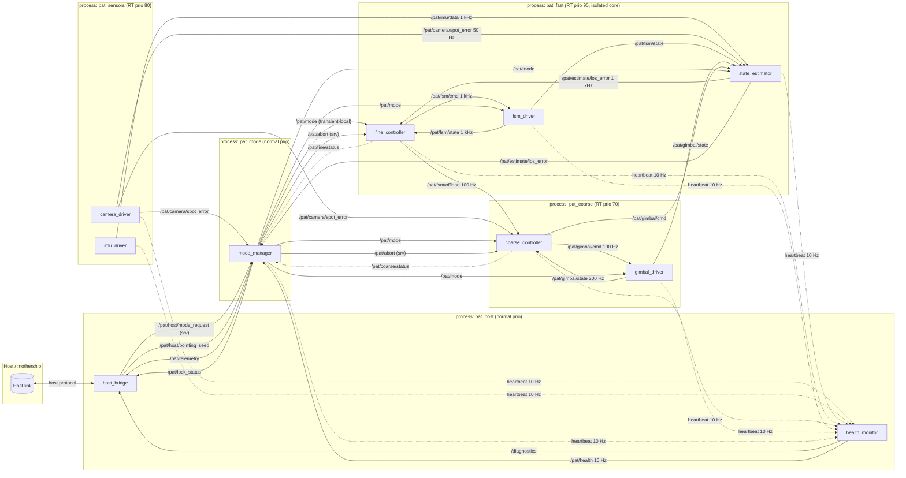
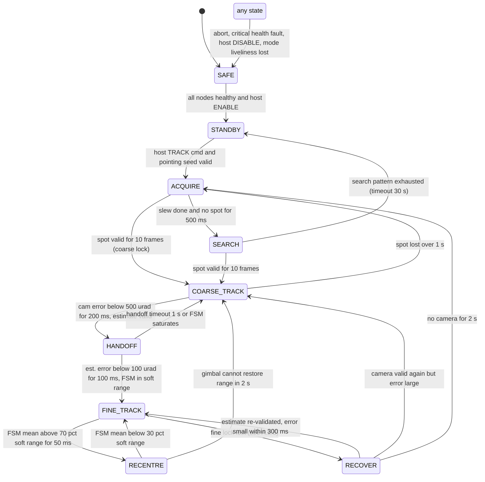

# PAT Terminal On-Board Software

ROS 2 Jazzy / C++17 / Ubuntu 24.04 / `rmw_cyclonedds_cpp`. On-board software for a two-axis (azimuth/elevation) laser-communications pointing, acquisition and tracking (PAT) terminal.

| Part | Content |
|---|---|
| [**Part A**](#part-a--system-architecture) | System architecture: nodes, control hierarchy, timing, middleware, failure handling |
| [**Part B**](#part-b--risk-ranking) | Risk ranking and why the highest-ranked risk was implemented first |
| [**Part C**](#part-c--implementation) | Implementation of delayed camera fusion: build, run, test evidence, internals |

Section references such as `A.3.3`, `CD-6`, `TD-4`, `AD-3` point into the git-ignored design documents `docs/design_part_a.md` and `docs/design_rationale.md`.

> Every numeric value that is not derived from the brief is an **assumption**, marked `[A]`. They are physically plausible and internally consistent, not a description of any specific hardware.

---
---

# Part A — System Architecture

**Target:** ROS 2 Jazzy (`rclcpp` 28.x), Ubuntu 24.04 LTS, RMW `rmw_cyclonedds_cpp`. The fast path is intended for a PREEMPT_RT kernel (Ubuntu `linux-realtime`, or a self-built PREEMPT_RT 6.8).
**Scope:** the host link protocol, optics and electronics are out of scope and abstracted behind driver nodes.

## A.0 Scope, conventions and assumptions

### A.0.1 What the software must do

1. **Point** — slew the gimbal to a host-supplied direction (or search around it) so the counterpart beacon lands on the camera.
2. **Acquire** — detect the beacon spot, drive it toward boresight with the gimbal, and hand command authority to the fast steering mirror (FSM).
3. **Track** — hold the beacon on boresight at kHz bandwidth with the FSM while the gimbal slowly keeps the FSM centred, through platform motion, vibration, camera dropouts and IMU glitches.
4. **Report and obey** — accept host mode commands, publish telemetry and health, and fall back to a safe state on any fault it cannot bound.

### A.0.2 Assumptions

| Area | Assumption |
|---|---|
| Dimensionality | Two coupled pointing axes. Camera gives a 2-D spot error `(ex, ey)`; FSM and gimbal are each 2-DOF. Cross-axis coupling is a small, calibrated rotation between camera, FSM and gimbal frames. `[A]` |
| Frames | `platform` (IMU body), `optical` (boresight, rigid to platform), `camera` (pixels, mapped to `optical` by static calibration), `fsm` and `gimbal` actuator frames. Static transforms are loaded as parameters. `[A]` |
| Units and signs | Angles in **µrad**, rates in **rad/s**, time in ns (`builtin_interfaces/Time`). Positive `ex` = spot right of boresight = line of sight (LOS) must rotate +az to correct. Positive actuator command rotates LOS positively. `[A]` |
| Camera | Measures the **residual** optical error after gimbal and FSM have acted. 50 Hz, 20–30 ms exposure-to-message latency with ±5 ms jitter, 1-σ noise 5 µrad, confidence `[0,1]` from spot SNR. `[A]` |
| Camera timestamp | `header.stamp` = exposure mid-time on a clock synchronised with the IMU (same host clock or PTP). Message arrival time is never used for estimation. `[A]` |
| IMU | 1 kHz angular rate, latency < 1 ms, rate noise 50 µrad/s/√Hz, slow bias drift (minutes); rigid to the optical bench with a known fixed `platform→optical` rotation. Only the gyro channels are fused, to propagate platform motion between camera frames; accelerometers and gravity tilt are not used (translation and structural vibration estimation are out of scope; relative translation appears through the target LOS trajectory). `[A]` |
| Gimbal (coarse) | ±60° az / ±30° el; max rate 20°/s; closed-loop bandwidth ≈ 5 Hz; position feedback 200 Hz; command resolution ≈ 50 µrad. `[A]` |
| FSM (fine) | ±2 mrad mechanical; second-order low-pass (ωn ≈ 2π·800 rad/s, ζ ≈ 0.7); strain-gauge feedback at 1 kHz. `[A]` |
| Acquisition | Host seed pointing with ≈ ±0.5° uncertainty; camera FOV ±1°, so a short spiral search is the fallback, not the default. `[A]` |
| Lock definition | **Coarse lock**: camera error < 500 µrad, confidence > 0.6, ≥ 10 consecutive frames (200 ms). **Fine lock**: estimated LOS error < 20 µrad RMS over 100 ms with FSM in soft range. **Lock lost**: fine criterion violated > 100 ms, or no valid camera frame > 200 ms. `[A]` |
| Disturbance | Base motion up to 1°/s, vibration 1–200 Hz at 100 µrad RMS. The FSM must reject this; the gimbal cannot. `[A]` |
| Compute | Single multi-core Linux SBC (≥ 4 cores), PREEMPT_RT, one isolated core for the fast path. `[A]` |

### A.0.3 Measurement model

Let `θ_tgt(t)` be the true direction to the beacon in the platform frame, `θ_plat(t)` the platform attitude disturbance, `θ_g(t)` the gimbal angle and `θ_f(t)` the FSM angle (both mapped into the optical frame). The camera sees the **residual**:

```
e_cam(t_k) = θ_tgt(t_k) − θ_plat(t_k) − θ_g(t_k) − θ_f(t_k) + n_cam          (2-vector, µrad)
```

The IMU measures `ω_plat(t) = dθ_plat/dt + b + n_imu`. Consequences:

- The estimator state is the **residual LOS error** `e(t)`, not platform attitude. Between camera frames it is propagated with `ė = −ω_plat − θ̇_g_cmd − θ̇_f_cmd`; actuator motion we commanded is subtracted so it is not re-corrected when the next camera frame arrives.
- The FSM controller acts on `ê(t)` directly. In FINE_TRACK the gimbal acts on the **FSM position**, not on `ê`, which keeps the two loops from fighting (A.2.3).

---

## A.1 ROS 2 node architecture

### A.1.1 Diagram



Solid arrows: data flow. Dashed: status/health. `srv`: ROS 2 service. `transient-local`: latched QoS.

### A.1.2 Node responsibilities

| Node | Owns | Subscribes | Publishes / serves | Rate | Process |
|---|---|---|---|---|---|
| `camera_driver` | Camera hardware, exposure control, centroiding, pixel→µrad calibration, exposure timestamping | `/pat/mode` | `/pat/camera/spot_error` (`SpotError`: stamp = exposure mid-time, `ex, ey` µrad, `confidence`, `valid`, `seq`) | 50 Hz | `pat_sensors` |
| `imu_driver` | IMU hardware, bias table, `platform→optical` rotation | — | `/pat/imu/data` (`sensor_msgs/Imu`, optical frame) | 1 kHz | `pat_sensors` |
| `state_estimator` | Residual-LOS estimate `ê`, covariance, delayed-measurement buffer, data-age counters | `/pat/imu/data`, `/pat/camera/spot_error`, `/pat/fsm/state`, `/pat/gimbal/cmd`, `/pat/gimbal/state`, `/pat/mode` | `/pat/estimate/los_error` (`LosEstimate`: `ex, ey, vx, vy`, covariance, `camera_age_ms`, `imu_age_ms`, `valid`) | 1 kHz (IMU-driven) | `pat_fast` |
| `fine_controller` | FSM command and integrator, saturation-margin detector, offload request, bumpless-transfer init | `/pat/estimate/los_error`, `/pat/fsm/state`, `/pat/mode` | `/pat/fsm/cmd` (`FsmCmd`), `/pat/fsm/offload` (`OffloadRequest`: low-passed FSM mean, margin flag), `/pat/fine/status`; serves `/pat/abort` | 1 kHz | `pat_fast` |
| `fsm_driver` | FSM DAC/amplifier, strain-gauge readout, command-timeout watchdog → hold centre | `/pat/fsm/cmd`, `/pat/mode` | `/pat/fsm/state` (`FsmState`: `x, y`, `saturated`, stamp) | 1 kHz | `pat_fast` |
| `coarse_controller` | Gimbal command and integrator, slew profile, spiral search, offload loop | `/pat/camera/spot_error`, `/pat/fsm/offload`, `/pat/gimbal/state`, `/pat/mode`, pointing seed (via `mode_manager`) | `/pat/gimbal/cmd` (`GimbalCmd`: az/el position + rate), `/pat/coarse/status`; serves `/pat/abort` | 100 Hz | `pat_coarse` |
| `gimbal_driver` | Motor controller interface, encoders, rate/range limiting, command-timeout watchdog → stop | `/pat/gimbal/cmd`, `/pat/mode` | `/pat/gimbal/state` (`GimbalState`: az/el pos, vel, `at_limit`) | 200 Hz | `pat_coarse` |
| `mode_manager` | PAT state machine, command authority, lock-quality hysteresis and dwell timers, transition counters, pointing seed | `/pat/camera/spot_error`, `/pat/estimate/los_error`, `/pat/fine/status`, `/pat/coarse/status`, `/pat/health`, `/pat/host/pointing_seed` | `/pat/mode` (`Mode`: state, authority, `seq`, stamp; **transient-local**), `/pat/lock_status`, `/pat/telemetry`; serves `/pat/host/mode_request`; calls `/pat/abort` | 50 Hz + events | `pat_mode` |
| `health_monitor` | Heartbeat and data-age tables, deadline-miss aggregation, fault latching | all `heartbeat` topics, `/diagnostics` sources | `/pat/health` (`Health`: per-node OK/DEGRADED/FAILED), `/diagnostics` | 10 Hz | `pat_host` |
| `host_bridge` | Host link socket/protocol, telemetry rate-limiting and packetisation | `/pat/telemetry`, `/pat/lock_status`, `/pat/health`, `/diagnostics` | `/pat/host/pointing_seed`; calls `/pat/host/mode_request` | 10 Hz | `pat_host` |

### A.1.3 Process allocation rationale

| Decision | Reason |
|---|---|
| `state_estimator`, `fine_controller`, `fsm_driver` **share one process** (`pat_fast`) | The kHz estimator→controller→driver path uses intra-process communication (zero-copy `unique_ptr`), so the 1 ms loop never crosses DDS. One RT thread, one isolated core. |
| `camera_driver`, `imu_driver` **in their own process** | Drivers block on hardware I/O; a camera stall must not starve the fast executor. IMU latency over CycloneDDS loopback is ~100–200 µs `[A]`, acceptable against a 1 ms period. |
| `coarse_controller` + `gimbal_driver` **together, separate from fast** | Different timing class (100 Hz); gimbal bus I/O (CAN/serial) blocks. |
| `mode_manager` **alone** | It is the safety authority. If it dies, every node detects loss of `/pat/mode` liveliness and safes independently (A.4.4). |
| `host_bridge` + `health_monitor` **together, normal priority** | Network-facing, may block on sockets; a slow host must never back-pressure control. |

---

## A.2 Control hierarchy: coexistence, handoff, loss of lock, saturation

### A.2.1 State machine



All thresholds and dwell times are `[A]` and are ROS parameters with units in their names.

### A.2.2 Command authority

`mode_manager` publishes an `authority` field inside `/pat/mode`. Exactly one node has write authority over each actuator at any time; drivers enforce it by ignoring commands whose `authority_seq` does not match the latest mode.

| State | Gimbal authority | FSM authority | Gimbal behaviour | FSM behaviour |
|---|---|---|---|---|
| SAFE | `gimbal_driver` (self) | `fsm_driver` (self) | Stop, hold (brake if available) | Drive to centre, hold |
| STANDBY | `coarse_controller` | none | Hold | Centre, outputs disabled |
| ACQUIRE | `coarse_controller` (slew profile) | none | Rate-limited slew to seed | Centre |
| SEARCH | `coarse_controller` (spiral) | none | Spiral about seed, pitch = ½ FOV | Centre |
| COARSE_TRACK | `coarse_controller` (camera loop) | none | Close loop on `e_cam` at 100 Hz, BW ≈ 2 Hz | Centre |
| HANDOFF | `coarse_controller` (frozen) | `fine_controller` | Hold last cmd, integrator frozen | Close loop on `ê`, gains ramped 0→1 over 50 ms |
| FINE_TRACK | `coarse_controller` (offload, idle) | `fine_controller` | Offload loop armed but deadbanded | Full-bandwidth loop on `ê` |
| RECENTRE | `coarse_controller` (offload, active) | `fine_controller` | Drive FSM mean → 0 at ≤ 0.1°/s | Keep tracking + feedforward of gimbal motion |
| RECOVER | `coarse_controller` (hold) | `fine_controller` (coast) | Hold | Hold last command, integrator frozen, coast on IMU-only estimate |

### A.2.3 Why the two loops do not fight

The loops are **nested with frequency separation**, not parallel on the same error:

```
                      ┌────────────────────────────────────────┐
                      │ FINE LOOP (1 kHz, BW ≈ 100–150 Hz [A]) │
   ê (estimator) ───▶ │  PI + lead, anti-windup, soft limits   │ ───▶ FSM cmd ───▶ FSM
                      └────────────────────────────────────────┘           │
                                                                    θ_f (FSM pos)
                                                                           │ low-pass 2 Hz
                      ┌────────────────────────────────────────┐           ▼
   0  ───────────────▶│ OFFLOAD LOOP (100 Hz, BW ≈ 0.2 Hz [A])│ ◀── FSM mean
                      │  I-only + deadband                     │ ───▶ gimbal cmd ───▶ gimbal
                      └────────────────────────────────────────┘
```

- In FINE_TRACK the gimbal never looks at the camera; its setpoint is "FSM mean = 0". Gimbal motion is a slow disturbance the fine loop easily rejects (0.2 Hz vs ≥ 100 Hz).
- `/pat/gimbal/cmd` also enters the estimator's propagation term (A.0.3), so commanded gimbal motion is fed forward into `ê` and the FSM starts moving the opposite way before any gimbal error is visible. Residual coupling is only gimbal servo tracking error, which is small and slow.
- In COARSE_TRACK the roles swap: the gimbal closes on `e_cam` and the FSM is held at centre. No state has both loops closing on the camera error.

### A.2.4 Handoff (COARSE_TRACK → HANDOFF → FINE_TRACK)

Goal: transfer lock without a pointing jump, and stop the gimbal integrating a residual the FSM is about to take over.

1. **Pre-condition** (`mode_manager`): `|e_cam| < 500 µrad` for 200 ms, estimator `valid=true`, `camera_age_ms < 60`, FSM feedback healthy, FSM at centre.
2. **Entering HANDOFF:** `coarse_controller` freezes its integrator and holds the last command. `fine_controller` initialises bumplessly (integrator set so the initial FSM command equals the current FSM position) and ramps P/D gains 0→100 % over 50 ms `[A]`. The estimator is **not** reset; it has been running through COARSE_TRACK.
3. **Confirmation:** `|ê| < 100 µrad` for 100 ms with FSM in soft range → FINE_TRACK; the offload loop is armed with a deadband.
4. **Failure:** FSM saturation during HANDOFF (signals a bad estimate or large disturbance, since 500 µrad is well inside ±2 mrad) or 1 s without confirmation → COARSE_TRACK, FSM to centre, gimbal integrator unfrozen. Three attempts within 10 s `[A]` drop to ACQUIRE, preventing handoff/fallback oscillation.

### A.2.5 Loss of lock

Lock quality `q` is computed by `mode_manager` from estimate validity, `camera_age_ms`, windowed RMS of `ê` and camera confidence. Lock is declared at `q > 0.8` for 100 ms and lost at `q < 0.4` for 100 ms `[A]` (hysteresis + dwell). More than 5 transitions per 10 s `[A]` escalates to COARSE_TRACK with a 2 s hold (anti-chatter).

| Situation | Response |
|---|---|
| 1–2 missed camera frames (`camera_age` 20–100 ms) | Invisible to the controller. Estimator coasts on IMU, covariance grows. Not a loss of lock. |
| Camera gap 100–200 ms | Still FINE_TRACK; integrator gain halved `[A]` once `camera_age_ms > 100` to limit bias-driven drift. |
| Camera gap > 200 ms, or `q` collapses | → RECOVER. FSM **holds last command** (centring would throw away good pointing), integrator frozen, IMU-only estimate with inflated covariance, gimbal holds. |
| Camera returns within 300 ms, `|ê|` small | → FINE_TRACK directly (no handoff ritual). |
| Camera returns, `|ê|` large (> FSM soft range) | → COARSE_TRACK: FSM ramps to centre over 100 ms, gimbal re-closes on camera. |
| No camera for 2 s | → ACQUIRE: re-slew to last good LOS (estimate + gimbal position), then SEARCH if needed. |

### A.2.6 FSM saturation and recentring

1. **Detecting approach to the limit.** `fine_controller` low-passes FSM *position feedback* at 2 Hz `[A]` to get the FSM mean (vibration excursions are high-frequency and not to be offloaded). Soft range = 70 % of mechanical range (±1.4 mrad). When `|mean| > 70 %` for 50 ms it publishes `/pat/fsm/offload` with `margin_low=true` and the mean. Hard saturation (`fsm_driver` reports `saturated`) is a separate, faster signal that clamps the integrator immediately.
2. **Requesting recentring.** `mode_manager` sees `margin_low` → RECENTRE. `coarse_controller` runs an integral-only offload loop, rate-limited to 0.1°/s `[A]`, driving FSM mean → 0. The gimbal integrates on the FSM mean rather than being told "move X µrad", so servo and calibration error are absorbed.
3. **Fine loop while the gimbal moves.** Gains unchanged; gimbal feedforward in the estimator lets the FSM unwind in lockstep, and any residual is a sub-Hz disturbance inside the fine loop's rejection band.
4. **Windup and discontinuities.** Fine loop: back-calculation anti-windup against the *soft* limit, commands rate-limited to FSM slew capability. Offload loop: ±10 % range deadband `[A]`, integrator clamped to the gimbal rate limit and frozen when FSM feedback is stale. No output ever steps on a mode change; every transfer is a hold or a ramp.
5. **Gimbal cannot restore range.** After 2 s `[A]` in RECENTRE with `margin_low` still true → COARSE_TRACK (FSM ramps to centre, gimbal re-closes on camera at full 2 Hz bandwidth). If the gimbal is at a hard limit (`at_limit`), `mode_manager` reports `LIMIT_REACHED` to the host and goes to STANDBY.

---

## A.3 Timing and latency budget

### A.3.1 Loops and real-time class

| Loop / path | Period | Trigger | Class | Deadline | Owner |
|---|---|---|---|---|---|
| IMU propagate + FSM control + FSM command | 1 ms | IMU message arrival (not a timer, so IMU jitter is not doubled) | **Hard RT** | 1 ms (miss = hold last cmd) | `pat_fast` |
| FSM feedback read | 1 ms | `fsm_driver` poll | Hard RT | 1 ms | `pat_fast` |
| Camera correction in estimator | 20 ms | camera message | Soft (bounded) | 20 ms | `pat_fast`, separate callback group |
| Gimbal control / offload | 10 ms | timer | Firm | 10 ms | `pat_coarse` |
| Gimbal feedback | 5 ms | driver poll | Firm | 5 ms | `pat_coarse` |
| Mode manager tick | 20 ms | timer + events | Soft | 50 ms | `pat_mode` |
| Health monitor | 100 ms | timer | Soft | 500 ms | `pat_host` |
| Telemetry to host | 100 ms | timer | Best effort | none | `pat_host` |

Only the IMU→estimator→FSM chain is hard RT. Everything else is designed so that lateness degrades estimate quality or recentring speed, never FSM loop timing.

### A.3.2 Latency budget per critical path (all `[A]`)

**Path 1 — IMU → FSM (disturbance rejection)**

| Stage | Budget | Note |
|---|---|---|
| 1. Physical measurement | t₀ | IMU internal filter delay ≈ 0.3 ms, included in stamp |
| 2. Message available | +0.2 ms | SPI read + publish in `imu_driver` |
| 3. Transport + scheduling into `pat_fast` | +0.15 ms | CycloneDDS loopback, RT wake-up < 50 µs on PREEMPT_RT |
| 4. Computation (propagate + control) | +0.05 ms | Fixed-size matrix ops; target < 50 µs |
| 5. Actuator command applied | +0.2 ms | Intra-process to `fsm_driver`, DAC write |
| **End-to-end** | **≈ 0.9 ms** | **Adds ≈ 32° phase at 100 Hz — the dominant limiter on fine-loop bandwidth** |

**Path 2 — Camera → estimator → FSM (bias/drift correction)**

| Stage | Budget | Note |
|---|---|---|
| 1. Exposure mid-time | t₀ | Exposure 2 ms, stamp = mid-exposure |
| 2. Message available | +20–30 ms | Readout, centroiding, publish; ±5 ms jitter |
| 3. Transport + scheduling | +0.3 ms | Lower-priority callback group |
| 4. Computation | +0.1 ms | Delayed-measurement update (A.3.3) |
| 5. Applied to FSM | next 1 ms tick | Correction flows into `ê` |
| **End-to-end** | **≈ 21–31 ms** | **Applied naively as "current error" it would inject a 25 ms-old disturbance — hence A.3.3** |

### A.3.3 Keeping the slow path from contaminating the fast path

Terms: **period** (nominal loop spacing), **execution time** (callback CPU time), **end-to-end latency** (physical event → actuator), **jitter** (variation of any of these), **data age** (now − stamp of the newest measurement used).

1. **The controller never waits for vision.** `fine_controller` runs on every IMU sample and consumes the latest `LosEstimate`. With no new camera frame the estimate is IMU-propagated with a higher `camera_age_ms`. No camera message reaches the controller.
2. **Corrections are applied at the right time, not at arrival time.** The estimator keeps a ring buffer (≥ 100 ms; 128 entries as implemented) of past states and IMU increments. A frame stamped `t_k` is applied to the buffered state at `t_k`, then the stored increments are re-propagated to now. A 25 ms-old measurement is never treated as a current error. (Risk 1 in Part B; implemented in Part C.)
3. **Stale and out-of-order measurements are rejected in the estimator**, not the controller: older than the buffer, older than the last accepted frame, or > 3σ `[A]` from prediction with low confidence → dropped and counted.
4. **Execution context isolation.** Camera correction and fast tick are in different callback groups; the correction is handed over lock-free (SPSC queue plus seqlock-protected ring), so the fast tick never blocks on a mutex (A.4.3).
5. **Deadline-miss policy.** Fast tick late by > 1 ms: `fsm_driver` holds the last command (a 1 ms hold is harmless, a centring step is not); the miss is counted in `/pat/fine/status`. > 10 misses in 1 s `[A]` → `health_monitor` marks `fine_controller` DEGRADED → COARSE_TRACK. > 100 in 1 s, or `fsm/cmd` silent 20 ms → `fsm_driver` centres on its own and `mode_manager` → SAFE.

### A.3.4 What "hard real time" means here

A 1 ms `rclcpp` timer is not a real-time guarantee. The design relies on a PREEMPT_RT kernel (the stock generic kernel gives no latency bound), `SCHED_FIFO` 90 for the fast executor thread, an isolated core, `mlockall` + pre-faulted stacks, no heap allocation after `configure`, and no logging, disk or service calls in the fast path. Verification reports timing percentiles (p50/p99/p99.9/max), deadline-miss count over total ticks, duration, hardware/kernel/RMW configuration, and clock source. A clean laptop run is evidence about that run, not a worst-case bound.

---

## A.4 Middleware: QoS, executors, callback groups, discovery

### A.4.1 QoS per interface

| Interface | Reliability | Durability | History | Deadline / liveliness | Rationale |
|---|---|---|---|---|---|
| `/pat/imu/data` | best-effort | volatile | last 1 | deadline 2 ms, liveliness auto 10 ms | Freshest sample matters; depth 1 prevents backlog on the fast path. |
| `/pat/camera/spot_error` | best-effort | volatile | last 3 | deadline 40 ms | Depth 3 absorbs jitter without a stale queue (estimator rejects by stamp anyway). |
| `/pat/estimate/los_error` | best-effort | volatile | last 1 | deadline 2 ms | Intra-process to the controller; latest-only. |
| `/pat/fsm/cmd`, `/pat/gimbal/cmd` | best-effort | **volatile** | last 1 | deadline 2 ms / 20 ms | Commands must **never** be latched: a late-joining driver must not replay an old command. Drivers also enforce a command timeout. |
| `/pat/fsm/state`, `/pat/gimbal/state` | best-effort | volatile | last 1 | deadline 2 ms / 10 ms | Same as sensors. |
| `/pat/fsm/offload` | reliable | volatile | last 1 | — | Low-rate event-like flag; a dropped `margin_low` would delay recentring. |
| `/pat/mode` | **reliable** | **transient-local** | last 1 | liveliness manual-by-topic 100 ms | Late joiners get the current mode immediately; depth 1 so no mode history is replayed. Liveliness lets every node detect `mode_manager` death and safe itself. |
| `/pat/lock_status`, `/pat/fine/status`, `/pat/coarse/status` | reliable | volatile | last 5 | — | Low rate; a lost message would delay a transition. |
| `/pat/host/pointing_seed` | reliable | transient-local | last 1 | — | Persistent desired state; a restarted `mode_manager` must see the latest seed. |
| `heartbeat` topics | best-effort | volatile | last 1 | deadline 200 ms | The deadline-missed callback *is* the detection. |
| `/pat/health`, `/pat/telemetry`, `/diagnostics` | best-effort | volatile | last 10 | — | Must never block a publisher; slow host consumer is isolated in `pat_host`. |
| `/pat/host/mode_request` (srv) | reliable | — | — | client timeout 500 ms, 3 retries | One-shot with confirmation; `wait_for_service` with timeout, never in a control callback. |
| `/pat/abort` (srv) | reliable | — | — | timeout 50 ms | Belt-and-braces: abort is also carried in `/pat/mode`, so a service failure cannot prevent safing. |

All publishers and subscribers take QoS from shared constants in one header, so mismatch is impossible. Control topics are best-effort + deadline (reliable ≠ timely); application-level freshness (`camera_age_ms`, command stamps) is always checked in addition to QoS.

### A.4.2 Executors

| Process | Executor | Threads | Scheduling | Nodes |
|---|---|---|---|---|
| `pat_fast` | `SingleThreadedExecutor` **E1** (`EventsExecutor` as the measured alternative) | 1 | `SCHED_FIFO` 90, isolated core 3, `mlockall` | `fine_controller` fast group, `state_estimator` IMU group, `fsm_driver` |
| `pat_fast` | `SingleThreadedExecutor` **E2** | 1 | `SCHED_FIFO` 60, core 2 | `state_estimator` camera group, `fine_controller` status/offload/mode group |
| `pat_sensors` | `SingleThreadedExecutor` per driver | 2 | `SCHED_FIFO` 80 (IMU), 50 (camera) | `imu_driver`, `camera_driver` |
| `pat_coarse` | `MultiThreadedExecutor` | 2 | `SCHED_FIFO` 70 | `coarse_controller`, `gimbal_driver` |
| `pat_mode` | `SingleThreadedExecutor` | 1 | `SCHED_OTHER`, nice −10 | `mode_manager` |
| `pat_host` | `MultiThreadedExecutor` | 2 | `SCHED_OTHER` | `host_bridge`, `health_monitor` |

**Rule:** the executor running the FSM loop runs nothing that can take unbounded time. E1's only callbacks are the IMU subscription (propagate + control + publish), FSM state (copy) and a watchdog timer; everything else of those nodes is in a group on E2.

`StaticSingleThreadedExecutor` is deprecated in rclcpp 28, so it is not used; Jazzy's `SingleThreadedExecutor` rebuilds its wait-set only when entities change (never on E1 after `configure`), giving the same behaviour. `EventsExecutor` is still `experimental` in Jazzy, so it is a launch-parameter alternative included in the timing comparison, not the default.

### A.4.3 Callback groups and data transfer

| Node | Group | Type | Executor | Callbacks | Rule |
|---|---|---|---|---|---|
| `state_estimator` | `imu_grp` | MutuallyExclusive | E1 | `/pat/imu/data`, `/pat/fsm/state`, `/pat/gimbal/cmd`, `/pat/gimbal/state` | Propagation only; bounded, allocation-free |
| `state_estimator` | `cam_grp` | MutuallyExclusive | E2 | `/pat/camera/spot_error`, `/pat/mode`, parameters | Delayed correction; never writes the live estimate |
| `fine_controller` | `ctl_grp` | MutuallyExclusive | E1 | `/pat/estimate/los_error` (intra-process), 1 ms watchdog timer | The control law |
| `fine_controller` | `aux_grp` | Reentrant | E2 | `/pat/mode`, `/pat/abort` srv, 100 Hz status timer, offload publish | May block briefly; never touches controller state directly |
| `fsm_driver` | `io_grp` | MutuallyExclusive | E1 | `/pat/fsm/cmd`, `/pat/mode`, command-timeout timer | DAC write is non-blocking memory-mapped I/O `[A]` |

**State ownership.** Gains, integrator, mode and authority live in one `FastState` struct owned by `ctl_grp`. Mode changes from `aux_grp` arrive as a POD command through a lock-free SPSC queue that `ctl_grp` drains at the start of each tick and applies itself (freeze/ramp/reset). Camera corrections from E2 reach E1 the same way (Part C); E2 reads shared history only through a seqlock. No mutex is ever taken on E1.

**Fast-path audit** (by review and a unit test with an allocation-tracking allocator):

- [ ] No synchronous service calls in `ctl_grp` / `imu_grp` / `io_grp`.
- [ ] No file/console I/O; `RCLCPP_*` logging forbidden; counters exported from `aux_grp`.
- [ ] No `std::mutex`; only atomics and SPSC queues.
- [ ] Pre-allocated, loaned messages where the RMW supports it; fixed-size message types only.
- [ ] `rmw_publish` on CycloneDDS best-effort is non-blocking (verified under subscriber stall).
- [ ] Overload test: `SCHED_OTHER` busy-loop on all cores + stalled camera subscriber; report deadline-miss statistics.

### A.4.4 Start order, discovery, late join

| Concern | Behaviour |
|---|---|
| Arbitrary start order | All nodes are lifecycle nodes. `unconfigured → inactive` sets up pubs/subs and pre-allocates; `active` enables outputs. A launch-side manager activates in order: drivers → estimator → controllers → mode_manager → host_bridge. Nothing actuates while `inactive`. |
| Controller starts before `mode_manager` | No `/pat/mode` → authority `none` → outputs disabled. Transient-local delivers the current mode within one discovery cycle once it appears. |
| Driver starts after its controller | Commands are volatile, so nothing is replayed. The driver outputs safe (FSM centre / gimbal stop) until a **fresh** command with matching authority arrives. |
| `mode_manager` restarts | Liveliness on `/pat/mode` expires at every subscriber (100 ms) → authority `none`, drivers safe. It boots into SAFE; re-entry to tracking is deliberate, via the host. |
| DDS discovery delay (~1–2 s `[A]`) | Controller `activate` waits (with timeout) for publisher/subscription counts on required topics; `health_monitor` reports `WAITING_FOR_<topic>`. Discovery is restricted to localhost so host-network conditions cannot perturb it. |
| Intra-process comms | `use_intra_process_comms(true)` for `pat_fast`; topic names unchanged so nodes can later be split. |

---

## A.5 Failure handling

### A.5.1 Per-fault responses

| Fault | Detection | Still trustworthy | Response | Mode effect | Recovery |
|---|---|---|---|---|---|
| One missed camera frame | `camera_age_ms` > 40 | IMU, actuators, estimate (degraded) | Estimator coasts; covariance grows | None | Next valid frame |
| Camera gap 100–200 ms | `camera_age_ms` | IMU, estimate with growing bias error | Fine integrator gain halved | Stays FINE_TRACK, `lock_status.degraded=true` | Gain restored over 100 ms |
| Camera loss > 200 ms | `camera_age_ms`, deadline-missed | IMU (short-term), actuator feedback | FSM and gimbal hold, IMU-only propagation | → RECOVER; → ACQUIRE at 2 s; → STANDBY if camera driver FAILED | A.2.5 |
| Single IMU outlier | Innovation > 6σ `[A]` or rate > 10 rad/s `[A]` | Everything else | Sample dropped, previous rate used; counted | None | Immediate |
| IMU outlier burst (> 5 in 100 ms `[A]`) | Counter | Camera, actuators | Camera-only estimation (ZOH between frames, fine gains ÷4 `[A]`) | `degraded`; stays FINE_TRACK if `q` holds | IMU clean for 1 s |
| Total IMU loss (no message 5 ms) | Deadline-missed on `/pat/imu/data` | Camera 50 Hz, actuator feedback | Fast tick re-triggered by a 1 ms fallback timer; camera-only; fine BW ≈ 10 Hz `[A]` | → COARSE_TRACK | IMU back 1 s → HANDOFF |
| Stale FSM feedback (> 5 ms) | Deadline-missed on `/pat/fsm/state` | Command history, estimate | Offload loop frozen; saturation falls back to commanded value | RECENTRE forbidden; > 100 ms → COARSE_TRACK | Feedback resumes |
| Stale gimbal feedback (> 50 ms) | Deadline-missed | FSM, estimate | Gimbal output rate-limited to 0 | FINE_TRACK allowed, RECENTRE forbidden | Feedback resumes |
| FSM command timeout (20 ms) | Driver watchdog | Nothing from controller | Driver ramps to centre over 20 ms, flags fault | → SAFE via health | Controller restart + host enable |
| Gimbal command timeout (200 ms) | Driver watchdog | — | Gimbal stops, brake | → SAFE | Same |
| Fast-loop deadline misses | Counter in `fine_controller` | Depends | ≤ 10/s: log; > 10/s: DEGRADED → COARSE_TRACK; > 100/s: SAFE | As stated | Clean for 5 s |
| Host link loss | `host_bridge` timeout 1 s | All on-board sensing | **Keep tracking**; telemetry buffered in a bounded ring | None for 60 s `[A]`, then STANDBY unless `autonomous=true` | Host reconnects; mode reconfirmed |
| `mode_manager` death | `/pat/mode` liveliness lost | Local node state | Every node → authority `none`; drivers safe | Effective SAFE | Restart + host enable |
| Node crash in `pat_fast` | Heartbeat deadline, process monitor | — | Drivers die too; hardware watchdog on FSM amplifier / gimbal controller `[A]` safes them | SAFE | Respawn + host enable |
| FSM range unrecoverable | RECENTRE timeout, `at_limit` | All | → COARSE_TRACK or STANDBY with `LIMIT_REACHED` | A.2.6 | Host decides |

### A.5.2 Safe state

`SAFE` = FSM commanded to centre and held by its driver; gimbal stopped (brake if present); integrators zeroed; transmit inhibit asserted to the host (`lock_status.tx_ok=false`); telemetry continues. Every node can reach SAFE **independently** (driver watchdogs, liveliness) without `mode_manager`. Leaving SAFE always requires an explicit host `ENABLE`.

### A.5.3 Mode-transition safety rules

- Every transition has a dwell time (≥ 50 ms `[A]`); no state is entered and left on consecutive ticks.
- Lock/unlock use hysteresis (A.2.5), never a single comparison.
- > 5 transitions in 10 s → forced COARSE_TRACK hold for 2 s; > 3 such holds → STANDBY and report.
- Every transition is published with `seq`, cause code and triggering metric for post-flight reconstruction.
- Controllers apply transitions themselves (freeze/ramp), so a delayed `/pat/mode` can never produce a step.

---

## A.6 Traceability and status

| Brief (Part A) requirement | Section |
|---|---|
| Node architecture, diagram, ownership, topics/services; sensing, estimation, two-stage control, mode management, telemetry/health | A.1 |
| Control hierarchy: coexistence, acquisition → fine lock → hold; loss of lock; FSM saturation | A.2 |
| Timing and latency budget; hard-RT paths; slow path not contaminating fast path | A.3 |
| QoS; executors and callback groups; start order, discovery, late join | A.4 |
| Failure handling: sensor dropout, mode transitions, safe states | A.5 |

| Status | Items |
|---|---|
| Implemented and tested (Part C) | Delayed-measurement ring-buffer fusion in `state_estimator`; E1/E2 executor and callback-group layout; shared QoS, seqlock and SPSC primitives; synthetic plant and scorer |
| Modelled or simulated | Camera, IMU, FSM and gimbal dynamics; disturbance spectrum; camera latency, jitter and dropout |
| Designed, not implemented | `mode_manager` (handoff, recentring, hysteresis), `fine_controller`, `coarse_controller`, lifecycle manager, host protocol |
| Requires real hardware | Actuator models and limits, IMU/camera calibration and time sync, RT timing figures on the target SBC |

---
---

# Part B — Risk Ranking

Part A is internally consistent on paper. Part B says which parts are most likely to be wrong in a way that matters, ranks them, and justifies spending the Part C effort on the top one.

**Ranking criterion:** probability the implementation is wrong × consequence of being wrong × difficulty of detecting it before hardware. The third factor is weighted heavily: a fault that only appears on the bench is far more expensive than one a unit test can catch.

## B.1 Ranked risks

| Rank | Risk | Where | Score rationale |
|---|---|---|---|
| **1** | **Delayed, asynchronous camera fusion in `state_estimator`** — correcting a 20–30 ms old (±5 ms jitter) frame at its true time, replaying forward, rejecting stale/out-of-order frames, and handing the result to the 1 kHz tick without a mutex | A.0.3, A.3.2 Path 2, A.3.3, A.4.3, TD-4, TD-7 | High probability (the one algorithm Part A leaves as a sketch), total consequence (defeats fine lock), invisible in static testing |
| **2** | **Fast-path timing on E1** — 0.9 ms IMU→FSM budget, IMU-arrival triggering, no allocation/mutex/logging in the tick, deadline-miss escalation | A.3, A.4.2–A.4.3, TD-1, TD-3, TD-5, TD-6 | High consequence, but already hedged in the design, mostly discipline rather than algorithm, and unverifiable on this host (no PREEMPT_RT, no isolated core) |
| **3** | **Mode-manager logic** — bumpless HANDOFF, RECENTRE, loss-of-lock hysteresis + dwell + rate watchdog, 3-attempts-in-10-s guard | A.2, CD-4, CD-7, CD-8, A.5.3 | Largest surface for logic bugs and chatter, but a fully specified deterministic state machine that unit tests can pin down cheaply |

## B.2 Risk 1 — delayed camera fusion

### B.2.1 What can go wrong

The camera measures the residual at exposure time `t_k`; the message arrives ≈ 25 ms later, and the platform has moved in between. At 1°/s base motion that is 17 453 µrad/s × 0.025 s ≈ **436 µrad**. If the frame is applied as though current (TD-4 option a), the estimator is pulled toward a value that was true 25 ms ago, IMU propagation carries the error forward, and the next frame repeats it. Steady-state error converges to rate × delay — twenty times the 20 µrad fine-lock budget — as a 50 Hz excitation of the FSM. The design chose buffer-and-replay (option c) to avoid this, then left it unimplemented.

### B.2.2 Why it ranks first

1. **Silent in every test without motion.** With a static platform, options (a) and (c) give identical results; a bolted-down bench test passes and the first manoeuvre fails.
2. **Everything downstream trusts `ê`.** HANDOFF pre-conditions, RECOVER coast, the 100/200 ms gap thresholds (CD-6), the 3σ gate and the gimbal feedforward (A.2.3) all go through the estimate. A wrong estimator makes a correct mode manager decide correctly on wrong data, with no second line of defence.
3. **It sits on the hardest concurrency boundary.** The 50 Hz correction on E2 updates state that E1 reads at 1 kHz with no mutex (TD-7). Replaying 25–100 ms of increments in a bounded callback while E1 keeps appending is where data races and unbounded paths hide.
4. **It is fully verifiable in software now.** A.0.3 is explicit enough that a synthetic plant and the estimator can be checked against each other to µrad precision, with the apply-at-arrival baseline measured rather than asserted.

### B.2.3 Why not risks 2 and 3 first

- **Risk 2** is a hypothesis the design says it cannot prove without the target SBC (TD-10). On this host any percentile figure describes the laptop, not the design. Only the part inseparable from risk 1 was taken: the two-callback-group, two-executor split, since the lock-free hand-off only makes sense with two real threads.
- **Risk 3** has the most transitions, but every threshold, dwell and exit is specified (A.2.1, CD-8) and scripted lock-quality sequences can test it exhaustively in milliseconds. Its risk is volume, not uncertainty, and it is meaningless to exercise before the estimator exists, since its inputs are `valid`, `camera_age_ms` and windowed RMS of `ê`.

## B.3 What Part C had to demonstrate

| Claim | Evidence required | Result |
|---|---|---|
| Apply-at-arrival fails under motion | Error ≈ rate × delay at 1°/s | 444 µrad live, 436 µrad in unit test |
| Buffer-and-replay fixes it | Error inside the 20 µrad budget on the same stream | 11.4 µrad live (noise-limited); 0.4 µrad with perfect inputs |
| The gates work | Stale, out-of-order, future, low-confidence-outlier frames rejected and counted; validity expires at 200 ms | All verified; `valid` drops exactly in the > 200 ms portions of live camera gaps |
| The E1/E2 hand-off is sound | No mutex, no allocation, no torn state under concurrency | Zero allocations in the tick; two-thread stress test and live node consistent |

The tests also found a defect that design review had not: a half-sample lag from rectangular gyro integration, worth 10 µrad at 37 Hz (half the fine-lock budget), invisible by inspection and on a static bench.

## B.4 Residual risk after Part C

- **Risk 2** is untouched in substance: right executor shape and optional RT priority, but no timing evidence, and none can be gathered on this host.
- **Risk 3** is untouched: nothing consumes `ê` yet.
- **Within risk 1:** the drift-rate state stands in for an explicit gyro-bias state (AD-4 defers this to Allan-variance data); reported covariance is ~1.6× conservative and untuned; camera stamps are assumed to be exposure mid-time on the IMU clock (TD-4).

---
---

# Part C — Implementation

Delayed camera fusion in `state_estimator`: implemented, verified in isolation, then run as a ROS 2 node against a synthetic plant over the real middleware.

## C.1 Target environment

| Item | Value |
|---|---|
| ROS 2 | **Jazzy** (`rclcpp` 28.x, `rclcpp_lifecycle`) on Ubuntu 24.04 |
| RMW | `rmw_cyclonedds_cpp`, loopback-only configuration |
| Language | C++17 (`-Wall -Wextra -Wpedantic`, warning-free); Python 3.12 for scoring |
| Build | `colcon`, `ament_cmake`, `ament_cmake_gtest` |
| Extra system deps | none beyond `ros-jazzy-desktop` + `ros-jazzy-rmw-cyclonedds-cpp` |
| Kernel for the figures below | generic 6.17 / 7.0, **not** PREEMPT_RT; timing is development evidence only (TD-10) |

```
ros2_ws/src/
  pat_msgs/       fixed-size messages: SpotError, LosEstimate, FsmState, FsmCmd,
                  GimbalCmd, GimbalState, Mode, SimTruth (AD-7)
  pat_common/     header-only: qos.hpp (the only place QoS is defined), topics.hpp,
                  units.hpp, SeqlockBuffer, SpscQueue (TD-7)
  pat_estimator/  pat_estimator_core (ROS-free ResidualLosEstimator) +
                  state_estimator lifecycle node + two-executor executable
  pat_sim/        PlantModel physics + synthetic_plant node, scenario configs,
                  score_estimate.py, run_scenario.sh
```

## C.2 Build and run

### C.2.1 Build and unit tests

```bash
sudo apt install ros-jazzy-rmw-cyclonedds-cpp        # once
source /opt/ros/jazzy/setup.bash
export RMW_IMPLEMENTATION=rmw_cyclonedds_cpp
cd ros2_ws
colcon build --symlink-install --cmake-args -DCMAKE_BUILD_TYPE=RelWithDebInfo
source install/setup.bash

colcon test --event-handlers console_direct+     # no ROS graph needed
colcon test-result --verbose
```

Expected: 27 gtest cases, 0 failures (`colcon test-result` prints 30 because it also counts the three ctest wrappers).

### C.2.2 Run against the synthetic plant (preferred: scenario runner)

```bash
# <fusion_mode> <plant.yaml> [scored_duration_s] [settle_s] [label]
install/pat_sim/lib/pat_sim/run_scenario.sh replay \
    src/pat_sim/config/plant_motion_1degs.yaml 10 2 "replay, 1 deg/s"
install/pat_sim/lib/pat_sim/run_scenario.sh apply_at_arrival \
    src/pat_sim/config/plant_motion_1degs.yaml 10 2 "baseline, 1 deg/s"
install/pat_sim/lib/pat_sim/run_scenario.sh replay \
    src/pat_sim/config/plant_camera_gaps.yaml 14 1 "camera gaps + gimbal ramp"
```

The runner launches `synthetic_plant` + `state_estimator`, waits 3 s, scores `/pat/estimate/los_error` against `/pat/sim/truth`, prints a report and shuts both nodes down. It **refuses to start if plant or estimator processes already exist** (see C.3.5). Sample report:

```
--- score (replay, 1 deg/s) ---
matched samples      : 9937  (estimates received 11936)
error  RMS / p99 / max: 11.38 / 25.98 / 36.52 urad
error  RMS while valid: 11.38 urad  (valid 100.0 % of samples)
|err|/sigma median    : 0.63  (~0.8-1.2 means the covariance is honest)
camera_age_ms  p50/p99: 36.1 / 49.1
modes                 : IMU_AND_CAMERA 100.0 %
camera frames accepted/rejected: 762 / 2; imu samples rejected: 0
```

### C.2.3 Run manually

```bash
# terminal 1
ros2 launch pat_estimator estimator_sim.launch.py \
    fusion_mode:=replay \
    plant_params:=$PWD/src/pat_sim/config/plant_motion_1degs.yaml \
    estimator_params:=$PWD/src/pat_estimator/config/estimator_default.yaml \
    fast_thread_priority:=0

# terminal 2 — must select the same RMW and Cyclone config as the launch file
export RMW_IMPLEMENTATION=rmw_cyclonedds_cpp
export CYCLONEDDS_URI=file://$PWD/src/pat_sim/config/cyclonedds_localhost.xml
ros2 lifecycle get /state_estimator                 # -> active [3]
ros2 topic hz /pat/estimate/los_error               # ~1000 Hz
ros2 run pat_sim score_estimate.py --duration 10 --settle 2 --label manual
```

Plant alone: `ros2 launch pat_sim plant.launch.py [params:=file.yaml]`.
Launch arguments: `fusion_mode` = `replay` (TD-4 option c, default) or `apply_at_arrival` (measured baseline); `fast_thread_priority` = `SCHED_FIFO` priority for the E1 thread, `0` = off (needs `CAP_SYS_NICE`; without it the node warns and continues).

### C.2.4 Scenario files and gotchas

| File (`pat_sim/config/`) | What it exercises |
|---|---|
| `plant_default.yaml` | All `[A]` assumptions of A.0.2; static platform with 100 µrad vibration |
| `plant_motion_1degs.yaml` | 1°/s base motion, camera 25 ± 5 ms — the TD-4 case |
| `plant_camera_gaps.yaml` | 150 ms and 400 ms camera gaps (CD-6 thresholds) plus a 0.1°/s gimbal RECENTRE ramp |

Knobs: `platform_rate_deg_s`, `vib_rms_urad`, `camera_latency_ms`, `camera_jitter_ms` (> 10 ms produces out-of-order frames), `camera_dropout_prob`, `camera_gaps_s`, `imu_gaps_s`, `imu_bursts_s`, `imu_glitch_rate_hz`, `gimbal_profile: hold|ramp|sine`, `fsm_profile: hold|sine`.

- ROS 2 YAML cannot express an empty list parameter; omit a schedule parameter to disable it.
- Scripts publishing on a control topic must use the deadline QoS from `pat_common/qos.hpp`, or the middleware silently drops them.
- Before trusting a live number, check `pgrep -af "lib/pat_sim/synthetic_plant|lib/pat_estimator/state_estimator"` shows exactly one of each.

## C.3 Tests and results

### C.3.1 Live, end-to-end over CycloneDDS (`run_scenario.sh`)

Laptop, generic kernel, normal priority. Each row is a separate clean run, 10 s scored after a 2 s settle (14 s / 1 s for the gap scenario). Error is `|ê − e_true|` matched by header stamp at ~1 kHz.

| Scenario | `fusion_mode` | RMS / p99 / max (µrad) | valid | Notes |
|---|---|---|---|---|
| 1°/s base motion, 100 µrad vibration, camera 25 ± 5 ms + 5 µrad noise, gyro bias 200 µrad/s + 50 µrad/s/√Hz | **replay** | **11.4 / 26.0 / 36.5** | 100 % | 762 frames accepted, 2 rejected at start-up; 998 Hz output; `|err|/σ` 0.63 |
| same | **apply_at_arrival** | **443.8 / 565 / 583** | 100 % | = rate × delay (436 µrad) as TD-4 predicts; `|err|/σ` = 45, so the covariance does not know it is wrong |
| 0.2°/s, camera gaps 150 / 400 ms, gimbal ramp 0.1°/s from t = 3 s | replay | 12.5 / 32.0 / 39.6 | 96.5 % | `IMU_ONLY` 5.7 % of samples (age > 100 ms); `valid=false` exactly in the > 200 ms portions; max 39.6 µrad coasting 400 ms with 698 µrad of commanded gimbal motion fed forward |

With the assumed sensors, replay fusion keeps the residual inside the 20 µrad fine-lock budget at 1°/s; apply-at-arrival exceeds it 20×. The 11 µrad floor is gyro noise (≈ 7 µrad random walk between 20 ms frames) plus camera noise, not fusion error: the same estimator reaches 0.4 µrad on noise-free inputs.

Also checked live: `ros2 lifecycle get /state_estimator` → `active`; `fast_thread_priority:=50` without privilege → `SCHED_FIFO 50 not applied (Operation not permitted); running at normal priority`, node continues.

### C.3.2 Plant node alone, live

| Check | Result |
|---|---|
| Topic rates (300-sample window) | IMU 999 Hz, camera 50.2 Hz, FSM state 1000 Hz, gimbal state 200 Hz, truth 1000 Hz |
| Camera latency = receive − `header.stamp` (352 frames) | min 21.2 / mean 25.9 / max 30.4 ms |
| Camera `ex` vs truth at same stamp (351 matched) | residual σ 5.07 µrad, mean −0.07 |
| `ex == target − platform − gimbal − fsm` on every truth message | holds to 1e-9 |
| Platform vibration RMS from truth stream | 100 µrad |
| External `/pat/fsm/cmd` = 500 µrad at 1 kHz | FSM settles at 500.0 µrad; profile overridden |

### C.3.3 `pat_estimator` unit tests (14, ROS-free scripted truth model)

| Test | Verified |
|---|---|
| `Fusion.StaticPlatformReplayEqualsApplyAtArrival` | no motion: modes agree within 1e-3 µrad |
| `Fusion.OneDegPerSecondMotionExposesApplyAtArrival` | baseline ≈ 436 µrad (±15 %); replay < 5 µrad RMS, < 10 peak |
| `Fusion.JitteredDelayWithVibrationStaysAccurate` | 0.5°/s + 100 µrad @ 37 Hz, 25 ± 5 ms jitter, 5 µrad noise → 4.15 µrad RMS; jitter adds 0.03 µrad |
| `Fusion.OutOfOrderFramesAreRejectedNotFused` | 15 ms jitter → `out_of_order` > 0, accuracy unchanged |
| `Fusion.GimbalCommandIsFedForwardWithoutCamera` | 1 s of 0.1°/s commanded motion, camera off → < 5 µrad, `valid=false` |
| `Fusion.MeasuredFsmMotionIsSubtracted` | 800 µrad @ 3 Hz FSM motion → < 5 µrad RMS |
| `Gates.StaleFutureInvalidAndOutlierFrames` | out-of-order, too-old (> 128 ms ring), future (> 5 ms), invalid, 3σ-with-low-confidence each rejected into its own counter; same jump at confidence 0.95 accepted |
| `Gates.CameraGapGrowsCovarianceAndExpiresValidity` | 70 ms valid; 170 ms valid, `IMU_ONLY`, P grown; 270 ms invalid; recovers |
| `Gates.CorrectionOlderThanRingIsCountedAsOverrun` | correction after ring wrap refused, never half-applied |
| `Imu.SingleSpikeIsDroppedWithoutDisturbingEstimate` | 20 rad/s sample counted, peak error < 5 µrad |
| `Imu.BurstSwitchesToCameraOnlyThenRecovers` | 10 bad samples in 10 ms → `CAMERA_ONLY`; nominal after 1 s clean |
| `Imu.AbsentImuIsCameraOnlyMode` | watchdog propagation reports `CAMERA_ONLY` |
| `FastPath.NoHeapAllocationInSteadyState` | global `operator new` counter: 100 propagations + prepare/apply + snapshot = **0 allocations** |
| `FastPath.ConcurrentCameraCorrectionsNeverCorruptState` | separate E1/E2 threads for 500 ms: > 50 corrections, estimate within 10 µrad, zero overruns; 5 reruns, no flakes |

Defect found: rectangular gyro integration lagged the true angle by half a sample (≈ 10 µrad at 37 Hz / 100 µrad). Trapezoidal integration cut the perfect-input residual from 9.7 to 0.38 µrad.

### C.3.4 `pat_sim` (8) and `pat_common` (5) unit tests

| Test | Verified |
|---|---|
| `PlantModel.MeasurementEquationHolds` | truth terms sum to 1e-9; analytic platform angle/rate match |
| `PlantModel.FsmStepResponseMatchesSecondOrderModel` | ζ = 0.7 → 4.6 % overshoot (1046 ± 10 on a 1000 step) |
| `PlantModel.FsmExactStepIsStableAtOneKilohertz` | exact ZOH converges at ωn·dt = 5 (Euler would diverge) |
| `PlantModel.FsmSaturatesAtRange`, `GimbalRateAndRangeLimits` | ±2000 µrad / 20°/s / ±60° with flags |
| `PlantModel.VibrationRmsAndRateAreConsistent` | 20 s RMS = 100 ± 5 µrad; analytic rate = numerical derivative |
| `PlantModel.GyroSampleIsTruthPlusBiasPlusNoise`, `CameraSampleIsTruthPlusNoise` | statistics match configured noise |
| `SeqlockBuffer.NeverObservesTornState` | 300 ms writer/reader stress, zero torn reads |
| `SpscQueue.FifoAndCapacity`, `CrossThreadOrdering` | 200 000 items in order across threads; full queue refuses, never blocks |
| `Units.Conversions` | deg↔µrad, ns↔`builtin_interfaces/Time` |

### C.3.5 What went wrong during testing

| Observation | Cause | Fix |
|---|---|---|
| Frames accepted rising at ~1 kHz instead of 50 Hz in first live runs | Killing `ros2 launch` from the tool harness orphaned nodes; two plants and two estimators shared the topics. The estimator was correct; the measurement was not. | `run_scenario.sh` refuses to start with stale processes and kills its children on exit. All C.3.1 numbers are from clean runs. |
| First `/pat/fsm/cmd` test publisher silently ignored | Script lacked the shared deadline QoS (*incompatible QoS: DEADLINE*) | Script fixed; the A.4.1 mismatch guard working as designed |
| `synthetic_plant` crashed with `camera_gaps_s: []` | ROS 2 cannot type an empty YAML list | Schedules omitted from default yaml; documented |
| Jitter unit test failed at 9.7 µrad with perfect inputs | Half-sample lag of rectangular integration | Trapezoidal integration (C.3.3) |

### C.3.6 Not tested / known limits

- No timing percentiles (TD-10): wall timers, generic kernel, normal priority; ~1 kHz rates are averages with unbounded jitter.
- Authority enforcement (`authority_seq`), `/pat/mode` handling and a lifecycle manager are not implemented; the estimator autostarts.
- The estimate is scored open-loop; no controller closes on it yet.
- Reported covariance is ~1.6× conservative (`|err|/σ` ≈ 0.63); untuned.

## C.4 How it works

### C.4.1 ResidualLosEstimator (ROS-free core)

State `x = [ex, ey, vx, vy]`: residual LOS error (µrad) and an unmodelled drift rate (µrad/s) that absorbs gyro bias and target LOS drift (AD-3, AD-4).

**Propagation (E1, every IMU sample, TD-1).** Discrete form of `ė = −ω_plat − θ̇_g_cmd − θ̇_f` (A.0.3): trapezoidal gyro rate, commanded gimbal rate from `/pat/gimbal/cmd`, and *measured* FSM position difference from `/pat/fsm/state`. `P` propagates through `F = [[I, dt·I],[0, I]]` with gyro white noise on `e` and random walk on `v`. Each step writes `{stamp, dt, u·dt, x, P}` into a 128-slot ring (≥ 100 ms, TD-4) guarded by a per-slot seqlock. IMU samples beyond 10 rad/s, or with a per-sample step > 1 rad/s, are replaced by the previous sample and counted; ≥ 5 rejections in 100 ms switch to camera-only propagation (zero rate, inflated Q) until 1 s clean (A.5.1).

**Delayed correction (E2, each camera frame, A.3.3).** `prepare_correction` gates the frame (invalid, older than last accepted, older than the ring, > 5 ms in the future), brackets the exposure stamp `t_k` in the ring through the seqlock, interpolates `x(t_k)` and propagates `P` to it, forms the innovation with `R = (σ_cam / confidence)²`, rejects a > 3σ innovation only if confidence < 0.6, and performs a Joseph-form Kalman update at `t_k`. It returns a POD `Correction {t_k, entry_index, alpha, x, P}` and never writes the estimate.

**Replay (E1, start of next tick).** `apply_correction` replays the ring from `entry_index` to the newest entry using the *stored* input increments, rewriting each entry so later frames interpolate against corrected history, and adopts the result as the live state. If the ring has wrapped past `entry_index` the correction is refused and counted (`overrun`). The model is linear with known inputs, so replay is exact; cost is ≤ 128 small vector operations, no allocation, no mutex.

**`fusion_mode: apply_at_arrival`** forces `t_k := newest stamp` (the TD-4 baseline), kept selectable so the comparison is a measured number.

**Validity** (CD-6): `valid = camera_age < 200 ms ∧ ≥ 1 frame accepted ∧ trace(P_pos) < threshold`. `mode` is `IMU_ONLY` when camera age > 100 ms and `CAMERA_ONLY` when the IMU is in burst or absent.

### C.4.2 `state_estimator` node and process layout

`rclcpp_lifecycle::LifecycleNode`. Subscriptions and publisher are created in `on_configure`; outputs flow only when `active`. `autostart: true` configures and activates on first spin (a lifecycle manager would do this in the full system, AD-8).

| Callback group | Executor / thread | Callbacks |
|---|---|---|
| `imu_grp` (mutually exclusive) | **E1**: own `SingleThreadedExecutor` and thread, optional `SCHED_FIFO` | `/pat/imu/data` → drain correction queue, `propagate`, publish `LosEstimate`; `/pat/fsm/state`; `/pat/gimbal/cmd`; 2 ms IMU-loss watchdog (propagates with `imu_present=false` after 5 ms silence) |
| `cam_grp` (mutually exclusive) | **E2**: second `SingleThreadedExecutor` with the node's default group | `/pat/camera/spot_error` → `prepare_correction` → `SpscQueue<Correction, 8>` |

All inputs the fast tick reads (`fsm_pos_`, `gimbal_rate_`) are written only by `imu_grp` callbacks, so E1 owns all mutable estimator state; E2 reads the ring through the seqlock and communicates only through the SPSC queue (TD-7). QoS for every endpoint comes from `pat_common/qos.hpp` (A.4.1).

### C.4.3 Synthetic plant and scoring

`synthetic_plant` stands in for the camera, IMU, FSM and gimbal drivers (A.1.2), publishes on the real topics with the shared QoS, and publishes `/pat/sim/truth` for scoring only. Truth is analytic (`PlantModel::truth()`) from the A.0.3 measurement equation:

| Term | Model |
|---|---|
| `θ_tgt` | constant offset + linear LOS drift |
| `θ_plat` | constant rate + optional sway + vibration: log-spaced sinusoids with amplitude ∝ 1/f, random phase per axis, scaled to `vib_rms_urad`; angle and rate both analytic, so IMU and camera are exactly consistent |
| `θ_g` | first-order servo at 5 Hz, 20°/s rate limit, ±60°/±30° range with `at_limit` |
| `θ_f` | second-order low-pass (800 Hz, ζ 0.7) via exact ZOH; clamped at ±2 mrad with `saturated` |

Sensors: IMU at every 1 ms tick (white noise, bias + random walk, scheduled gaps and garbage bursts, Poisson spikes); camera at 50 Hz **stamped at exposure, delivered 25 ± 5 ms later** in arrival order, with random dropouts and scheduled gaps; FSM state at 1 kHz; gimbal state at 200 Hz. Actuators follow external `/pat/fsm/cmd` / `/pat/gimbal/cmd` if fresh within 200 ms, else an open-loop profile (`hold | ramp | sine`); in gimbal profile mode the plant republishes the command it follows so the estimator receives feedforward. Physics advance by measured wall-clock `dt` per tick (clamped 0.25–5 periods) and stamp with the node clock, so timer jitter appears as irregular spacing rather than stamp drift.

`score_estimate.py` subscribes to `/pat/estimate/los_error` and `/pat/sim/truth` with matching QoS, pairs messages by exact header stamp (the plant stamps IMU and truth identically per tick; the estimator stamps output with the IMU stamp), and reports RMS / p99 / max error, error while `valid`, valid fraction, `|err|/σ` from the published covariance, camera-age percentiles, mode occupancy and the estimator's own counters.
